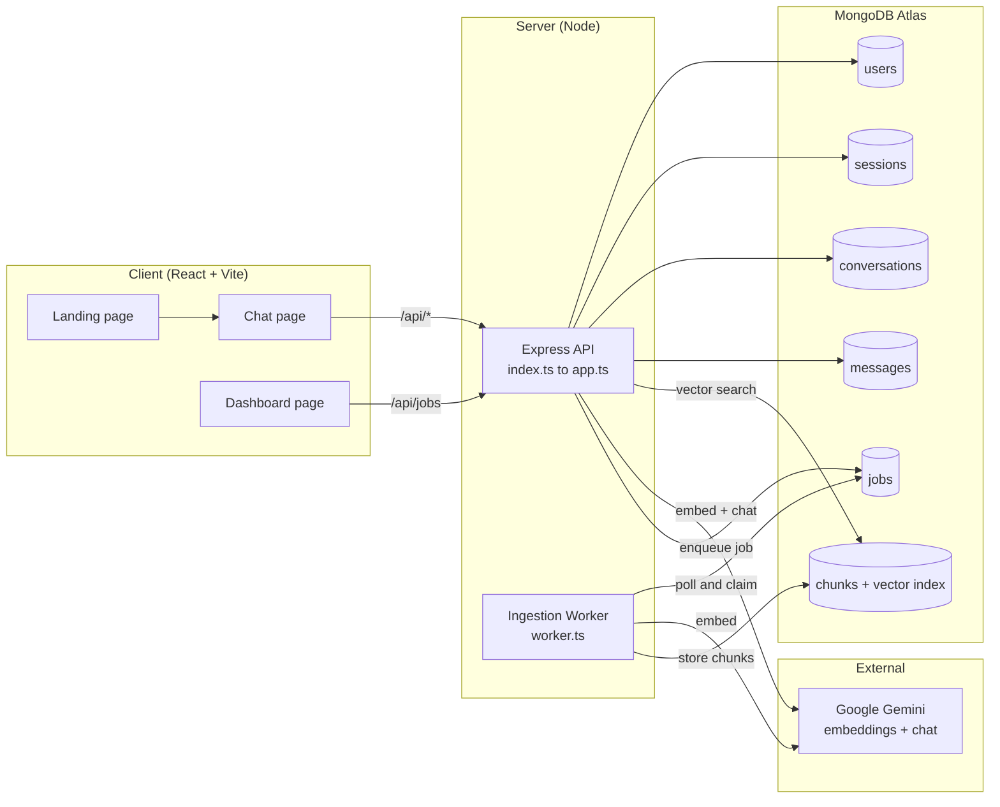
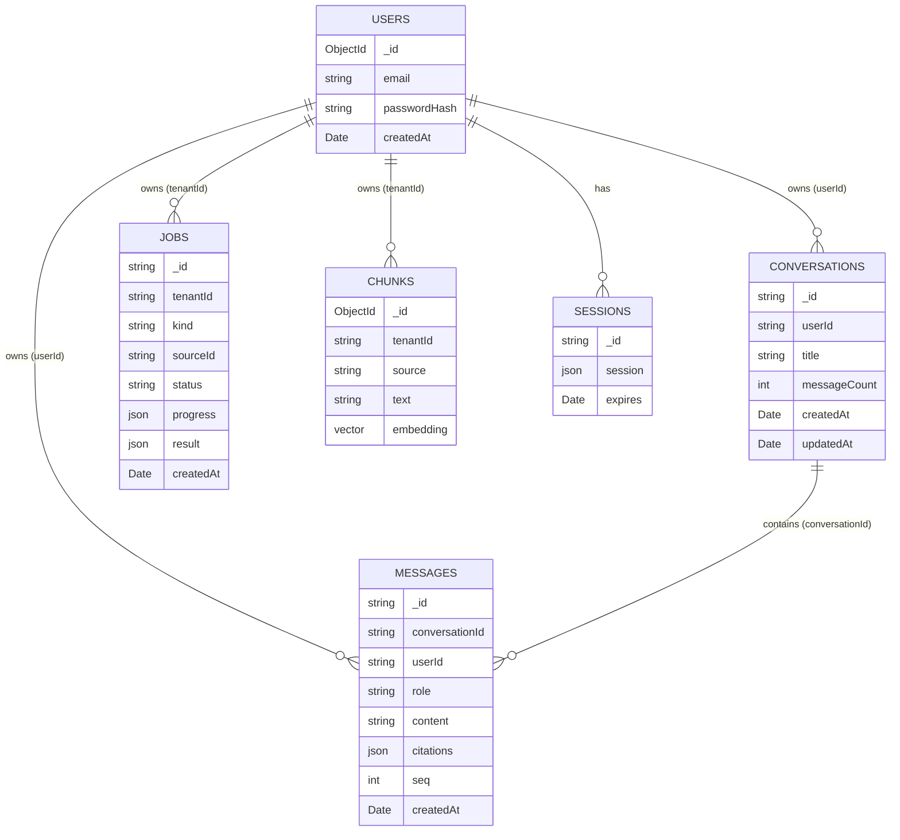
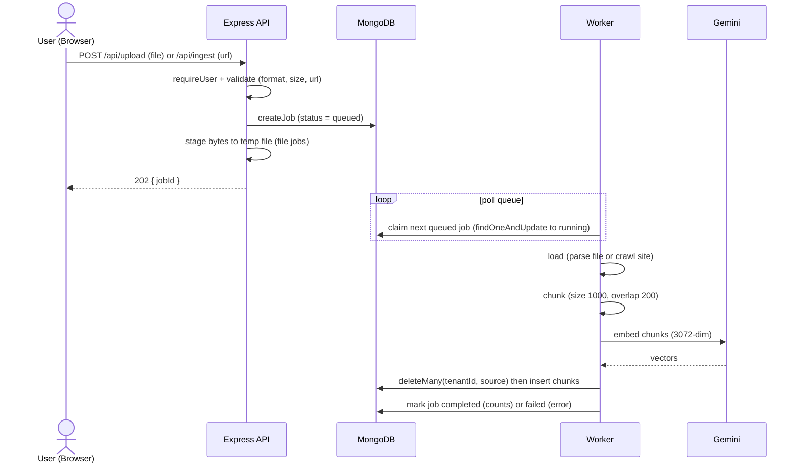
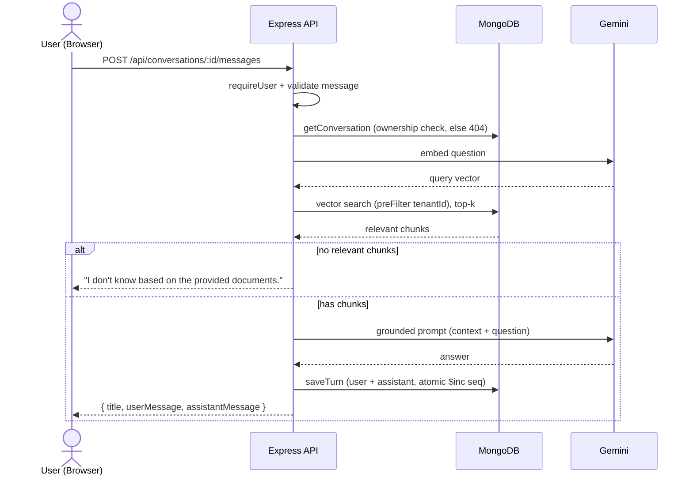
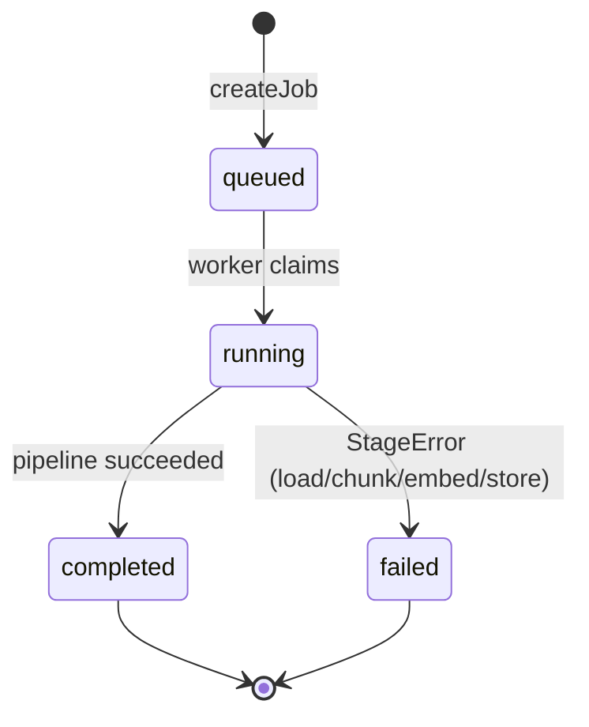
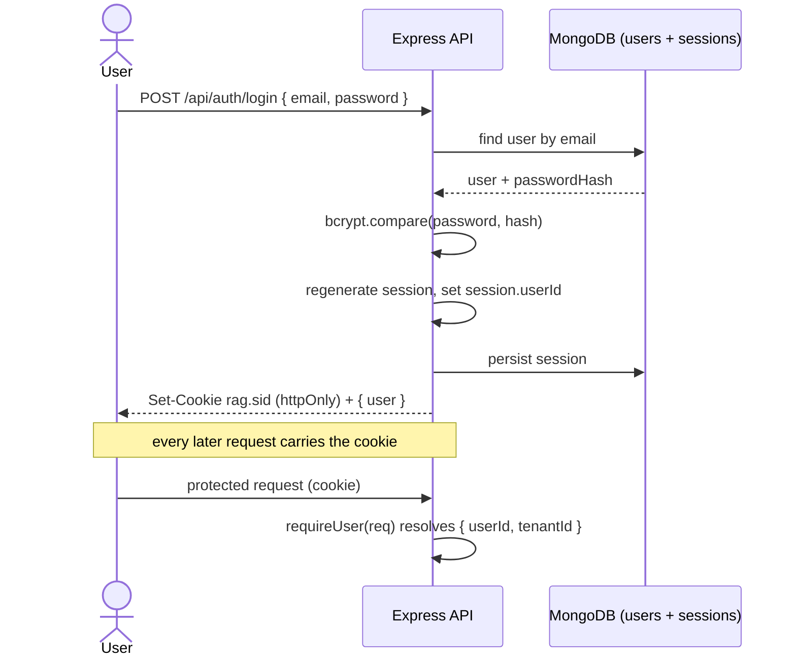
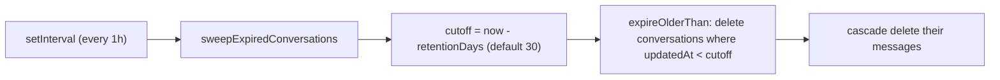

# ClearResolveAI — Architecture & How It Works

> A complete under-the-hood reference for the RAG-Chatbot project.

## What it is

ClearResolveAI is a RAG (Retrieval-Augmented Generation) chatbot. You feed it documents (PDF, Markdown, TXT, HTML, JSON) or entire websites, it turns them into a searchable knowledge base, and then it answers your questions using only that material — with citations back to the sources. Every user is isolated: you only ever search and see your own data.

The repo is a monorepo with two independently-run apps plus a background worker:

```
RAG-Chatbot/
├── client/   React + Vite + Tailwind (the UI)
├── server/   Express API + a separate ingestion worker
└── data/     sample content
```

The root `package.json` runs both sides together with `concurrently` (`npm run dev`).

**Tech stack:** React, Express (Node), LangChain.js, Google Gemini (embeddings + chat model), and MongoDB Atlas with a Vector Search index.

## The three processes

1. **API server** (`server/src/index.ts` → `app.ts`) — handles HTTP: auth, chat, conversation history, and enqueuing ingestion. It never does slow ingestion inline.
2. **Worker** (`server/src/worker.ts`) — a separate long-running process that polls MongoDB for queued ingestion jobs and runs the heavy pipeline (including launching a real Chromium browser via Playwright for website crawls). It also runs the retention sweep.
3. **MongoDB** — the shared backbone. It stores users, sessions, ingestion jobs, the vector chunks, and the chat conversations/messages. The API and worker share nothing but this database.

Splitting the worker out is deliberate: crawling websites with Playwright is heavy and fragile, so it runs out of band and the API stays responsive.

## The two core flows

### Flow A — Ingestion (getting documents into the knowledge base)

```
Upload/URL request → validate → enqueue Job (queued) → return 202 immediately
                                        │
                          Worker polls Mongo, claims job
                                        │
        load → chunk → embed → store  (the shared pipeline)
                                        │
                        Job marked completed/failed
```

Step by step:

1. **Request.** `POST /api/upload` (a file) or `POST /api/ingest` (a URL). Both authenticate first, validate the input (file format, size limit, valid URL), then call `createJob(...)`. Uploaded bytes are staged to a temp file keyed by the job id (the job document itself holds no bytes — just `kind` and `sourceId`). The route returns `202 { jobId }` right away.
2. **Claim.** The worker's poll loop atomically flips the next `queued` job to `running` with a `findOneAndUpdate`, so two workers can never grab the same job.
3. **The shared pipeline** (`ingestion/pipeline.ts`) runs four stages in order:
   - **load** — a loader registry (`loaders/index.ts`) picks the right parser by file extension (pdf/markdown/txt/html/json), or the Playwright scraper crawls the site. Output is plain-text documents tagged with a `source`.
   - **chunk** — LangChain's `RecursiveCharacterTextSplitter` splits text into overlapping windows (size 1000, overlap 200 from `config`). Overlap preserves context across boundaries.
   - **embed** — the shared `embedder()` factory (Gemini `gemini-embedding-001`, 3072 dimensions) turns chunks into vectors. Critically, the same factory is used at query time, so vectors are comparable.
   - **store** — `ingestion/store.ts` first deletes any prior chunks for the same `(tenantId, source)` (idempotent re-ingest — re-uploading replaces instead of duplicating), tags every chunk with `tenantId` + `source`, then inserts them with embeddings into the vector collection.

   Each stage is wrapped so a failure becomes a `StageError` naming which stage broke, and the pipeline halts for that source. Progress ticks are written to the job document so the dashboard shows live counts.
4. **Terminal state.** On success the runner records `{ documents, chunks }` and marks `completed`; on any throw it records the error message and marks `failed`.

### Flow B — Chat (asking questions)

```
Send message → auth → (create conversation if new) → answer() →
   embed question → Atlas vector search (tenant-filtered) →
   top-k chunks → build grounded prompt → Gemini → answer + citations →
   saveTurn (persist user + assistant messages atomically)
```

Step by step:

1. The client posts to `POST /api/conversations/:id/messages`. The route authenticates, validates the message is non-blank, and confirms you own that conversation (else 404).
2. `chat.ts`'s `answer(tenantId, message)` calls `getRelevantChunks`, which embeds the question with the *same* embedder and runs an Atlas vector similarity search — with a `preFilter` on `tenantId` so results can never cross into another user's data. It returns the top `k` (default 4) chunks.
3. If nothing relevant is found, it short-circuits and returns "I don't know based on the provided documents." without ever calling the model.
4. Otherwise it builds a grounded prompt ("answer using ONLY the context below"), calls Gemini `gemini-flash-latest`, and attaches one citation per distinct source chunk.
5. `saveTurn` persists the user message and the assistant reply as one atomic turn: it reserves two sequence numbers via an atomic `$inc`, inserts both messages in order, bumps `updatedAt` (so the conversation floats to the top of the sidebar), and derives the conversation title from the first message.

## How the pieces connect (data model)

MongoDB holds these collections, all keyed by the user (as `tenantId`/`userId`):

- **users** — email + bcrypt password hash.
- **sessions** — server-side sessions (via `connect-mongo`).
- **chunks** — the vector store: text + 3072-dim embedding + `tenantId` + `source`. Backed by an Atlas vector index (`atlas/vector-index.json`) that declares `embedding` as the vector field and `tenantId`/`source` as filter fields. That filter declaration is the *other half* of tenant isolation — without it the `preFilter` in the retriever would be silently ineffective.
- **jobs** — the ingestion queue (queued → running → completed/failed) with live progress.
- **conversations / messages** — chat history: one conversation document per thread, ordered message documents within it.

## Security and isolation model

- **Auth** is session-based (`express-session` + a signed, httpOnly cookie, sessions stored in Mongo). `requireUser(req)` is the single choke point every protected route calls first; it returns `{ userId, tenantId }` (they're equal) or throws a 401.
- **Tenant isolation** is enforced everywhere by scoping every query with the user id — chunk search is pre-filtered by `tenantId`, and conversation/job reads are filtered by owner. A record owned by someone else is indistinguishable from one that doesn't exist (you get a 404/403, never a leak).
- **Error handling** is centralized: a `handleRoute` wrapper maps typed `AppError`s to structured `{ error: { code, message } }` responses with the right HTTP status, and turns unexpected errors into a generic 500 without leaking internals.

## Config as single source of truth

`server/src/config.ts` centralizes every tunable — Mongo collection names, embedding model/dimensions, chat model, chunk size/overlap, retrieval `k`, file-size limit, crawl caps, session settings, and conversation retention (default 30 days, overridable via `RETENTION_DAYS`). Nothing reads magic literals directly, so enforcement and reporting can never drift apart. Required secrets (Mongo URI, session secret, vector index name) are validated at startup so misconfiguration fails fast.

## The client side

React Router serves three pages (`App.tsx`): a Landing page, the Dashboard (ingestion/job status), and Chat. The Chat page is the main surface — a sidebar listing your conversations (with search, rename, delete, new-chat) and the message view. All calls use `credentials: "include"` so the session cookie rides along, and errors are read from `data.error.message`. Retrieved answers and saved history render citations identically, so reopening an old conversation looks the same as a live answer.

## Key HTTP endpoints

| Endpoint | Method | Purpose |
|---|---|---|
| `/api/auth/register` | POST | Create a user and log in |
| `/api/auth/login` | POST | Log in |
| `/api/auth/logout` | POST | Destroy the session |
| `/api/auth/me` | GET | Current user or 401 |
| `/api/upload` | POST | Enqueue a file ingestion job (202 + jobId) |
| `/api/ingest` | POST | Enqueue a URL crawl/ingestion job (202 + jobId) |
| `/api/jobs` | GET | List the caller's ingestion jobs |
| `/api/jobs/:id` | GET | Fetch one job's status/progress |
| `/api/chat` | POST | One-off grounded answer (no persistence) |
| `/api/conversations` | POST / GET | Create / list conversations |
| `/api/conversations/:id` | GET / PATCH / DELETE | Open / rename / delete a conversation |
| `/api/conversations/:id/messages` | POST | Send a message (answer + save turn) |

## End-to-end, in one sentence

You log in → upload docs or a URL (which enqueues a background job the worker turns into tenant-tagged vector chunks) → ask a question → the server embeds it, vector-searches *only your* chunks, feeds the top matches to Gemini with a grounded prompt, returns a cited answer, and saves the turn to your conversation history — with a scheduled sweep expiring conversations older than the retention window.

## Run commands

```bash
# install everything (root + server + client)
npm run install:all

# run server + client together (dev)
npm run dev

# run the ingestion worker (separate process)
npm --prefix server run worker

# seed the DB / create the Atlas vector index
npm --prefix server run seed
npm --prefix server run atlas:create-index
```

## Diagrams

> Rendered with Mermaid. On GitHub these display automatically; in an editor use a Mermaid preview extension.

### 1. System architecture



### 2. MongoDB data model



### 3. Ingestion flow



### 4. Chat flow



### 5. Job lifecycle



### 6. Authentication and session



### 7. Retention sweep


